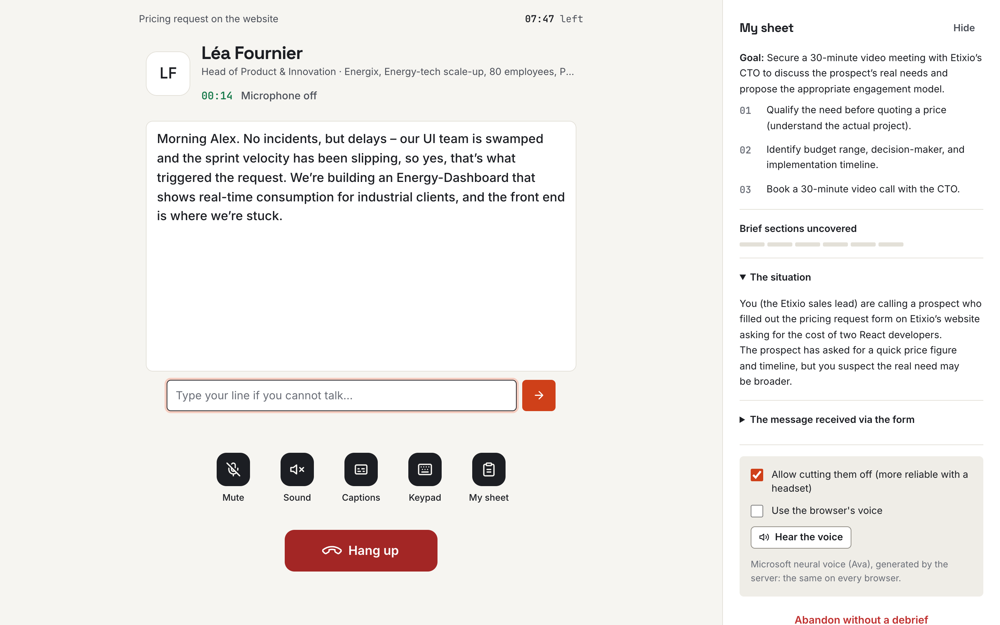
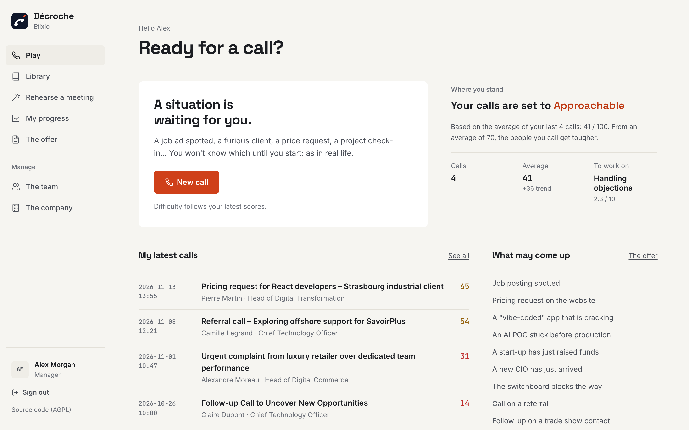
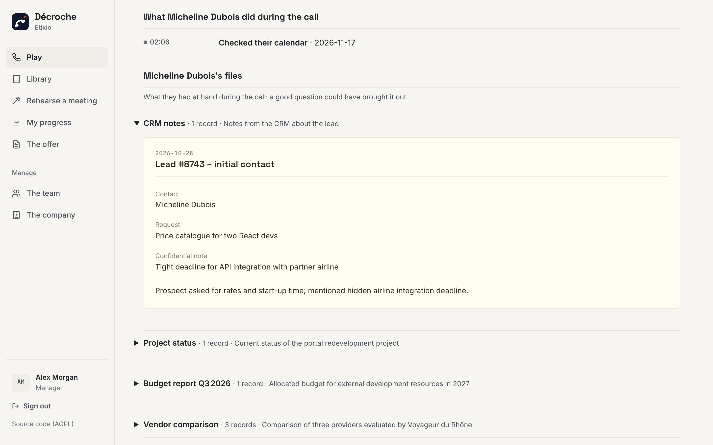
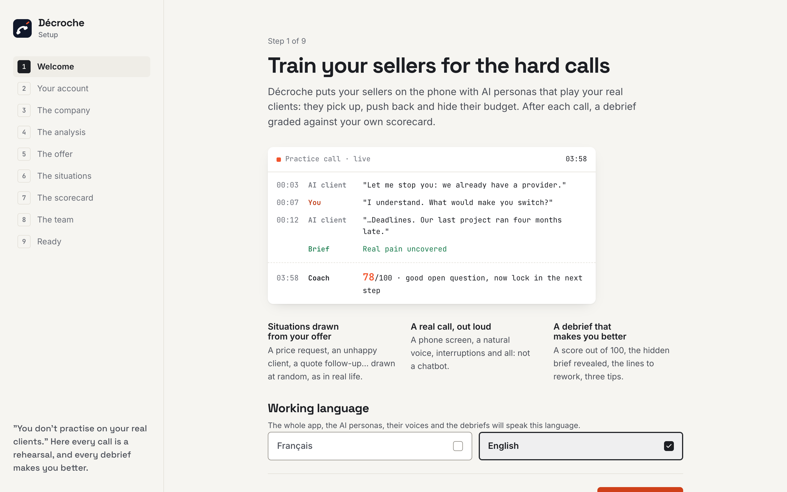
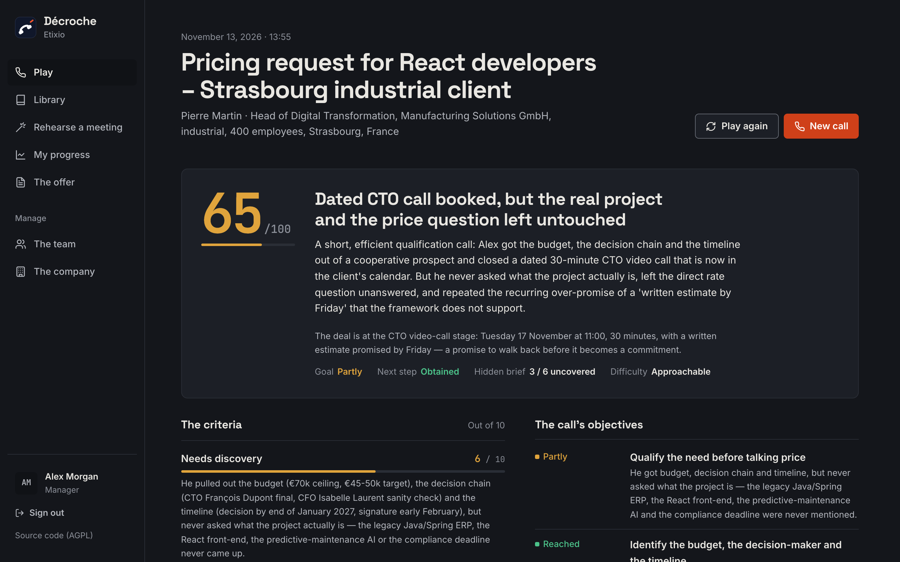

<p align="center"></p>

<h1 align="center">Décroche</h1>

<p align="center"><i>décroche</i> /de.kʁɔʃ/ — French for <i>"pick up the phone"</i>.</p>

<p align="center"><b>Rehearse your sales calls out loud, against an AI client who knows things you don't —<br>including the real client meeting you have tomorrow, straight from its e-mail thread in Claude.<br>Then get graded by a coach, and follow your progress.</b></p>

<p align="center">Symfony 8.1 · Symfony AI · MCP · Hugging Face Inference Providers · Kyutai Pocket TTS · PHP 8.5</p>

<p align="center">By Mathieu Bernard · <a href="https://etixio.com">Etixio</a></p>

<p align="center"><a href="docs/demo.mp4"><b>▶ Décroche in 90 seconds</b></a> · <a href="https://mbetixio.github.io/decroche/">Website</a> · Open source (AGPL-3.0) · built for the <a href="https://symfony.com/hackathon">Symfony AI &amp; MCP Hackathon</a> 2026</p>

<p align="center"></p>

---

**Try it in five minutes** — with Docker and a [Hugging Face token](#1-get-a-hugging-face-token-2-minutes):

```bash
git clone https://github.com/mbetixio/decroche.git && cd decroche
cp .env.docker.dist .env.docker     # paste your hf_… token after AI_API_KEY=
docker compose up -d --build        # about three minutes the first time
```

Then open <http://localhost:7077> in Chrome, Edge or Safari (Firefox has no speech recognition: you type on the
keypad there). Two ways to start:

- **For your own company** (the default): the onboarding starts. Pick the language, create the manager account, give
  your website: Décroche reads it and writes your offer sheet and 14–18 call situations in a minute or two. Review
  them, then press **New call** and allow the microphone.
- **On the example company**, with its team and debriefed calls already there: set `DECROCHE_DEMO=1` in
  `.env.docker` before the first start, then sign in with the demo manager's e-mail and password:
  `docker compose logs decroche | grep -A1 Manager`.

Hugging Face is the default, for the hackathon, but the model is yours to choose: any OpenAI-compatible API works
(OpenAI, DeepSeek, Mistral, a local Ollama or vLLM…). Set `AI_BASE_URL`, its key and the three models in
`.env.docker`: see [Configuration](#configuration). More in [Run it](#run-it): without Docker, in French, on a server.

---

## Why

Sales people learn on real prospects. Every fumbled discovery question, every price given too early, every
"let me send you a brochure" costs a deal — and nobody tells them what went wrong.

**Décroche is an open-source platform to train sales reps on realistic calls.** A seller picks up the phone (a real phone screen, with a voice,
not a chatbot) and talks to an AI client built from *their own company's* offer and situations: a price request from
the website, a furious client, a CTO who is about to leave, a renewal with a discount request… The client has a
**hidden brief** — their real budget, their real pain, who decides, their objections, what would get a yes — and only
gives it away to the right questions. When the seller hangs up, a coach grades the call against the company's own
scorecard, reveals the brief, quotes the best and worst lines, and lets them replay any moment.

Décroche is open source, built with Symfony AI for the hackathon: clone it, run it on the model you choose (open
models on Hugging Face by default, or any OpenAI-compatible API, your own server included), with the voices generated
offline on your server, and adapt it.

One instance per company: on first boot, a step-by-step onboarding reads the company's website and writes its offer
sheet and 14–18 call situations specific to its business, in English or French.

## What it does

| | |
|---|---|
| 🎲 **Calls drawn from your own business** | The onboarding analyses your website into an offer sheet and a catalogue of situations. Each *New call* draws one at random and writes a unique scenario around it: a person, a company, the document you have in front of you (laid out like a CRM record), three objectives, and a hidden brief. |
| 📞 **A real call, out loud** | Speech recognition in the browser, open voices generated server-side and offline (Kyutai's Pocket TTS: 14 French and 19 English voices), the reply streamed and voiced sentence by sentence, interruptions (barge-in), a timer. No text box unless you want the keypad. |
| 🗂️ **A client with their own files** | The client is a Symfony AI agent with tools. Each call comes with their workspace, written for their business: a calendar and two to four sources (support tickets, stock levels, suppliers, orders, e-mails, contracts… whatever fits). Ask about an incident and they say *"let me check…"* and quote their own records; propose a meeting and they open their calendar, then book it if they are free; mention last week's call and they remember it. The debrief shows what they did and what their files held. |
| 🎯 **A debrief that teaches** | A score out of 100 on your scorecard, the call's objectives judged one by one, the hidden brief revealed with what you missed and *the question that would have found it*, your best and worst lines quoted word for word with a better alternative, three tips, talk share and filler words. Replay the call from any of your lines, or *train on this point*: a new call built to test your weakest criterion. |
| 📈 **Progress that means something** | No XP or badges: the difficulty of your next calls follows your last five scores, and the home page tells you why, your trend, and the one criterion to work on. |
| 🧑‍💼 **Managers follow the team** | The team board (difficulty, average, trend, weakest criterion per seller), each seller's debriefs, missions ("3 price-request calls scored 70+ by Friday"), invitations, the company's own library of scenarios and scorecard. |
| 🤖 **Rehearse your next real call, from Claude** | Got a client meeting tomorrow? Ask Claude (connected to your mailbox) to get you ready: it reads the meeting's e-mail thread, and Décroche turns it into a practice call with *that* client — their context, their likely objections, a hidden brief — ready to take out loud in one click. Then, still in conversation, read your debriefs, ask why you keep losing at closing, and (for managers) follow and coach the team. |

<table>
<tr>
<td width="50%"><br><sub><b>Home</b> — one action, where you stand and why, what to work on.</sub></td>
<td width="50%"><br><sub><b>Briefing</b> — the situation, the document, the objectives; the person stays in view.</sub></td>
</tr>
<tr>
<td width="50%"><br><sub><b>Debrief</b> — the score, the criteria, the objectives, the call in figures.</sub></td>
<td width="50%"><br><sub><b>The client's tools</b> — what they looked up and booked during the call, and the files they had at hand.</sub></td>
</tr>
<tr>
<td width="50%"><br><sub><b>Team</b> — each seller's difficulty, average, trend and weak spot; missions.</sub></td>
<td width="50%"><br><sub><b>Progress</b> — scores over time, criteria, results by situation.</sub></td>
</tr>
<tr>
<td width="50%"><br><sub><b>Onboarding</b> — the instance sets itself up from the company's website.</sub></td>
<td width="50%"><br><sub><b>Sign-in</b> — a practice call writes itself while you sign in.</sub></td>
</tr>
<tr>
<td colspan="2"><br><sub><b>Dark theme</b> — every screen, light or dark, English or French.</sub></td>
</tr>
</table>

## Décroche in Claude (MCP)

The MCP server turns Claude (or any MCP client) into a sales coach that knows your company, your calls and your team.
Each member connects with a personal address, so Claude only ever sees what that member may see.

**Rehearse the call that is coming.** With Claude connected to your mailbox (a Gmail connector, for instance):

> *"Find the last e-mail from Satelis Mobile and get me ready for tomorrow's call with their CEO."*

Claude reads the e-mail, passes it to `prepare_call`, and Décroche writes a rehearsal of *that* meeting — the person,
their context, their likely objections and a credible hidden brief you will have to uncover. Claude hands you a
signed link: the phone screen opens in your browser, already signed in, and you rehearse out loud. A prospect sheet,
meeting notes or a CRM export work just as well.

**Understand your calls.**

> *"Show me the debrief of my last call."* · *"Compare my last three calls: what keeps going wrong at closing?"* ·
> *"Which questions would have found the budget?"*

The graded debrief appears right in the conversation (an MCP App), and `my_progress` gives Claude your scores, your
trend, your criteria and your missions to reason on.

**Coach a team** (managers).

> *"Who on my team struggles with objections? Give Jordan three objection calls scored 70+ before Friday."* ·
> *"Invite our new hire, sam@acme.com."*

**Or just practise.** *"Give me a call"* draws a surprise situation, *"Give me a call on objections"* one built to
train that criterion; with `mode: chat` the call is even played in writing, in the conversation.

**Ready-made requests.** The server also offers MCP *prompts*, in the client's "/" menu:

| Prompt | |
|---|---|
| `rehearse_meeting` | Gathers what your e-mails, calendar or notes say about an upcoming meeting, shows you the prospect sheet, then has `prepare_call` write the rehearsal. |
| `review_my_calls` | Reads your figures and debriefs, names the skill that holds you back with your own quotes, and offers a call that trains it. |
| `coach_my_team` | For managers: who progresses, who is stuck and on what, and missions to give once you approve them. |

And *resources* a client can attach to a conversation: `decroche://offer` (the offer sheet),
`decroche://situations` (the catalogue) and `decroche://scorecard` (the criteria the coach grades).

| Tool | |
|---|---|
| `prepare_call` | Writes a rehearsal of a real meeting from any text (an e-mail, notes, a prospect sheet); returns a call link or starts it in the chat. |
| `new_call`, `situations` | A surprise call drawn from the company's catalogue (or a given situation), optionally built to train one criterion (`focus`). |
| `library`, `call_link`, `start_call` | The managers' scenarios, a signed link to one, or playing it in the chat. |
| `reply`, `hang_up` | A call played in the chat: the seller's words relayed word for word, then the coach's debrief. |
| `debrief` | **MCP App**: the graded debrief, rendered in the conversation. |
| `my_progress` | Difficulty and why, scores and trend, criteria, results by situation, missions, latest calls. |
| `team`, `member_progress`, `give_mission`, `invite` | For managers. |

The persona's hidden brief never leaves the server while the call is on (it is shown once the call is debriefed or
abandoned): the client's model cannot whisper the answers.

**Connect it.** In Décroche, open *My account → Train from Claude → Create my MCP address*, then in Claude add a
custom connector with that address (`https://your-instance/mcp?key=pcl_…`; clients that can send headers may pass the
key as `Authorization: Bearer pcl_…` instead, which keeps it out of proxy logs). The key is stored hashed, redacted
from the logs, and closed when the member's password changes. The MCP endpoint needs a public HTTPS address for Claude
to reach it (see [Deploy](#deploy-on-a-server)).

## Run it

You need **an API key for a language model**. Décroche uses [Hugging Face Inference Providers](https://huggingface.co/docs/inference-providers)
by default — one token gives access to fast open models — and works with any OpenAI-compatible API.

### 1. Get a Hugging Face token (2 minutes)

1. Sign in or create a free account on [huggingface.co](https://huggingface.co).
2. Open [huggingface.co/settings/tokens](https://huggingface.co/settings/tokens) → **Create new token** → type
   **Fine-grained** → tick **"Make calls to Inference Providers"** → **Create token**.
3. Copy it right away: it starts with `hf_` and is shown only once.

The free account comes with a small monthly credit, enough to try. A practice call (twenty lines, the scenario and the
debrief) costs a few cents with the default model.

### 2a. With Docker (recommended)

All you need is [Docker](https://docs.docker.com/get-docker/) with Compose (Docker Desktop, or Docker Engine 24+ on a
server). Three commands:

```bash
git clone https://github.com/mbetixio/decroche.git && cd decroche
cp .env.docker.dist .env.docker          # then open .env.docker and paste your token after AI_API_KEY=
docker compose up -d --build             # about three minutes the first time
```

Open <http://localhost:7077>. The instance only answers on this machine until you have created the first manager
(whoever opens a fresh instance first becomes its manager). Then choose:

- **A real instance, set up from your company** (default): the onboarding starts. Pick the language, create the first
  manager account, give your website (analysed in a minute or two), review the offer, the situations and the
  scorecard, invite your team.
- **A demo instance, with test data**: set `DECROCHE_DEMO=1` in `.env.docker` (and `DECROCHE_LANGUAGE=fr` for French)
  before the first start, then read the demo manager's e-mail and password:

  ```bash
  docker compose logs decroche | grep -A1 Manager
  ```

  The onboarding is skipped: an example company (a software services firm), its 24 situations, a library of 7
  scenarios, and a small team are created. You sign in as its manager, Alex Morgan, who already has four debriefed
  calls (scores climbing from 36 to 62 in English, 12 to 62 in French, the coach naming the flaw that keeps coming
  back, the client looking up their files, checking their calendar and booking a meeting) next to a junior seller's two, so
  the home page, the progress, the team board and the MCP statistics are full from the start. Every scenario comes
  with its client's files.

**Everyday commands**

| | |
|---|---|
| `docker compose ps` | Is it running? `healthy` once it answers. |
| `docker compose logs -f decroche` | What it is doing (a model or a voice that fails is logged as a warning). |
| `git pull && docker compose up -d --build` | Update: the database is migrated at start, your data stays. |
| `docker compose down` | Stop it; the data stays in the `decroche` volume. `docker compose down -v` starts over. |
| `DECROCHE_PORT=8080 docker compose up -d` | Another port (then set `DEFAULT_URI` in `.env.docker` to match). |

**If it does not start**: `docker compose ps` shows *Restarting* and the logs say *AI_API_KEY is empty* when the key
is missing from `.env.docker`; *env file .env.docker not found* means the copy step was skipped. Every setting lives
in `.env.docker`: change it, then `docker compose up -d` again. The database, the sessions, the synthesized voices, the
voice models and the instance's own secrets live in the `decroche` volume.

**The voices.** The personas speak with [Kyutai's Pocket TTS](https://github.com/kyutai-labs/pocket-tts), an open model
that runs on the CPU, offline, in the container: as soon as the onboarding's first step has set the instance's
language, its server starts for that language only and downloads its model into the volume (no token, a few seconds),
while the rest of the onboarding goes on. It needs about
700 MB of memory and voices a sentence in under a second. Until then, or if it stops, Microsoft Edge's voices take over
(edge-tts), and the browser's own voice after that.

### 2b. Without Docker

Requires PHP 8.5 with `pdo_sqlite` and `intl` and [Composer](https://getcomposer.org); the voices are optional.

```bash
git clone https://github.com/mbetixio/decroche.git && cd decroche
composer install
printf 'AI_API_KEY=hf_your_token\nAPP_SECRET=%s\nMCP_STATE_KEY=%s\n' "$(openssl rand -hex 16)" "$(openssl rand -hex 32)" > .env.local   # never committed
python3 -m venv var/edge-tts && var/edge-tts/bin/pip install edge-tts==7.3.1   # optional: Edge's voices
```

For the open voices, run a [Pocket TTS](https://github.com/kyutai-labs/pocket-tts/releases) server (a single binary)
in the instance's language, and tell the app where it and the French voices are:

```bash
pocket-tts serve --port 8100 --language english     # or french
printf 'POCKET_TTS_URL=http://127.0.0.1:8100\nPOCKET_VOICES_URL=http://127.0.0.1:8000/voices\n' >> .env.local
```

Then either the onboarding:

```bash
php bin/console app:install            # creates the database; the first visit opens the onboarding
```

or the demo data:

```bash
php bin/console app:install --demo --language=en    # the example company, team and calls; prints the manager's e-mail and password
                                                     # (--email and --password to choose them)
```

and serve it:

```bash
symfony serve        # or: PHP_CLI_SERVER_WORKERS=4 php -S 127.0.0.1:8000 -t public   (several workers: the voices load while the reply streams)
```

**Use Chrome, Edge or Safari** (speech recognition) and allow the microphone. Without a microphone, the keypad on the
phone screen lets you type your lines. Without Pocket TTS or edge-tts, the browser's own voice speaks.

## Configuration

Put your values in `.env.docker` (with Docker, see `.env.docker.dist`) or `.env.local` (without Docker). With Docker,
only `AI_API_KEY` is required: the container generates the instance's own secrets once. Without Docker, also set `APP_SECRET` and
`MCP_STATE_KEY` (see [Without Docker](#2b-without-docker)).

| Variable | Default | |
|---|---|---|
| `AI_API_KEY` | — | **Required.** Your model provider's key: a Hugging Face token `hf_…` by default. |
| `AI_BASE_URL` | `https://router.huggingface.co/v1` | Any OpenAI-compatible endpoint (see below). |
| `AI_PERSONA_MODEL` | `deepseek-ai/DeepSeek-V4.1-Flash` | The client on the phone: its reply is streamed, so it must start fast. |
| `AI_COACH_MODEL` | `deepseek-ai/DeepSeek-V4.1-Flash` | The coach, who investigates the call then grades it, and the offer sheet. |
| `AI_WRITER_MODEL` | `openai/gpt-oss-120b` | The writer of each call and of its client's files: a long text, so it must write fast. The same model several times is fine. |
| `AI_PERSONA_REASONING`, `AI_COACH_REASONING`, `AI_WRITER_REASONING` | `low` | Reasoning effort, `none` to `high`, sent the way the model family expects it (gpt-oss, gpt-5, DeepSeek); ignored for other models. |
| `AI_LIMIT_CALLS_PER_HOUR`, `AI_LIMIT_LINES_PER_MINUTE` | `20`, `40` | Each member's share of the model: calls written (and debriefed) an hour, lines a minute. Far above what training takes, too tight for a script or a stolen key to run up the bill. |
| `AI_COMPLETIONS_PATH` | `/chat/completions` | |
| `AI_HEADERS` | `{}` | Extra HTTP headers for the model's API, as JSON. |
| `DEFAULT_URI` | `http://127.0.0.1:8000` | The instance's public address, for the links it generates (call links, invitations). |
| `MCP_ALLOWED_HOSTS` | `localhost,127.0.0.1,…` | Host names the MCP endpoint answers on: add your domain. |
| `TRUSTED_PROXIES` | — | Your reverse proxy, e.g. `private_ranges`: left empty, forwarded headers are not trusted. |
| `APP_SECRET`, `MCP_STATE_KEY` | generated (Docker) | The instance's own secrets: required without Docker. |
| `APP_TIMEZONE` | `Europe/Paris` | The clock of calendars, calls and missions. |
| `SOURCE_URL` | this repository | Where your users can get the source code, linked at the foot of every page (AGPL-3.0): point it at your fork if you modify Décroche. |
| `DECROCHE_DEMO`, `DECROCHE_LANGUAGE` | `0`, `en` | Docker only, in `.env.docker`: load the demo data instead of the onboarding. |
| `DECROCHE_PORT`, `DECROCHE_BIND` | `7077`, `127.0.0.1` | Docker only, given to `docker compose` itself (`DECROCHE_BIND=0.0.0.0 docker compose up -d`): the port, and the interface it listens on (`0.0.0.0` behind your proxy, once the first manager exists). |
| `POCKET_TTS_URL`, `POCKET_VOICES_URL` | set in Docker | The Pocket TTS server, and this app's `public/voices/` as that server reaches it. |
| `EDGE_TTS`, `VOICES_DIR` | `var/edge-tts/bin/edge-tts`, `var/voices` | Edge's voices (the fallback), and the cache of synthesized lines. |

**Choosing a model.** The persona answers in one to four sentences and must start *fast* (it is a phone call); the
coach reads the whole call against the offer and must be precise. We compared three set-ups on six real calls, with
the app's own prompts:

| | First word on the phone (median) | Debrief | Debrief quality |
|---|---|---|---|
| `deepseek-ai/DeepSeek-V4.1-Flash` on Hugging Face (**default**) | **1.5 s**, steady (0.6–1.9 s) | 7–12 s* | **The most precise**: notices a question asked twice, quotes the offer's real arguments |
| `openai/gpt-oss-120b` on Hugging Face | 2.1 s, uneven (up to 5.5 s) | **2–3 s** | Correct but more generic |
| DeepSeek V4.1 Flash on another provider | 1.8 s | 9–12 s | As precise as the default |

\* Measured on the plain answer. Since the coach investigates with its tools first (earlier debriefs, exact lines,
the client's actions, the offer), a debrief takes about 30 seconds, and the waiting screen shows each step.

Reasoning made the debriefs slower without making them better, so it is low by default: no thinking for DeepSeek, low
effort for gpt-oss. For faster debriefs, set `AI_COACH_MODEL=openai/gpt-oss-120b`.

The writer is the other way round: a call and its client's files are a long text, and gpt-oss writes it in about
5 seconds where DeepSeek takes 30 or more, so gpt-oss writes by default. Other providers:

| Provider | `AI_BASE_URL` | All three models |
|---|---|---|
| Hugging Face (default) | `https://router.huggingface.co/v1` | `deepseek-ai/DeepSeek-V4.1-Flash` |
| OpenAI | `https://api.openai.com/v1` | `gpt-5.4-mini` |
| DeepSeek | `https://api.deepseek.com/v1` | `deepseek-chat` |
| A local Ollama | `http://localhost:11434/v1` | `qwen3:32b` |

## Deploy on a server

The same three commands on any Linux server with Docker, then your HTTPS reverse proxy (Caddy, Traefik, Nginx Proxy
Manager…) in front of port 7077. Each team runs its own instance with its own key: the model's cost stays theirs.

1. On the server: `git clone`, `cp .env.docker.dist .env.docker`, put the key, and in `.env.docker` set
   `DEFAULT_URI=https://your-domain` and add the domain to `MCP_ALLOWED_HOSTS` (call links, invitations and Claude's
   connector use them).
2. `docker compose up -d --build`, then open the instance through an SSH tunnel (`ssh -L 7077:127.0.0.1:7077 server`
   and <http://localhost:7077>) and create the first manager account.
3. Point your proxy at it. A proxy on the same machine reaches `127.0.0.1:7077` as is; a proxy elsewhere (or in
   another container) needs `DECROCHE_BIND=0.0.0.0 docker compose up -d`. Set `TRUSTED_PROXIES` in `.env.docker` to
   the proxy's address (`127.0.0.1` for a local one) so that Décroche sees the real scheme and client address.

With Caddy, the whole proxy is `your-domain { reverse_proxy 127.0.0.1:7077 }`: HTTPS included. The replies stream as
they are written, so a proxy must not buffer the responses (Caddy and Traefik do not; with Nginx, the app already sends
`X-Accel-Buffering: no`). The container migrates the database and prunes old voices at each start.

**The landing page** is a single static file, `docs/index.html` (English and French, the same design as the app). To
publish it with GitHub Pages: *Settings → Pages → Deploy from a branch → `main`, `/docs`*.

## How Symfony AI, MCP and Hugging Face are used

- **Three agents with tools.** `config/packages/ai.yaml` declares three Symfony AI agents on a *generic* platform
  (Hugging Face Inference Providers by default), each with its model, its reasoning effort and its tools, plain
  services marked `#[AsTool]` (`src/Agent/`):
  - **the persona** (`look_up`, `check_calendar`, `book_meeting`, `previous_calls`) talks on the phone, streamed: a
    line said while a tool runs, then the rest, across the agent's rounds;
  - **the coach** (`previous_debriefs`, `find_in_transcript`, `client_actions`, `read_offer`) investigates the call:
    a mistake that keeps coming back, the exact lines, a meeting the client really booked, a promise checked
    against the offer;
  - **the writer** (`recent_calls`, `read_offer`) writes each call and its client's workspace.

  The tools know what they work on through `AgentContext`. Providers refuse, or ignore, tools next to a JSON schema,
  so the coach and the writer work in two steps (`LanguageModel::work()`): they investigate and write down notes,
  then the notes feed a strict structured answer.
- **A generic workspace.** `App\Model\Workspace` holds the client's calendar and sources of free records (a title, a
  date, fields, a note): no business is built in, the writer picks what fits the situation.
- **Structured output.** The coach, the writer and the offer analyst answer into classes
  (`src/Ai/Output/`, described with `#[Schema]` attributes): Symfony AI sends each class as a strict JSON schema
  (`response_format`) and turns the model's JSON back into the object (`asObject()`). The criteria come as a list,
  since every company writes its own scorecard.
- **Streaming end to end.** The persona's reply is a stream of `TextDelta`s (`Persona::reply()`), filtered of its
  control markers (`[devoiler:budget]` when a brief section is given away, `[fin]` when the persona hangs up), cut into
  sentences (`SentenceSplitter`), each voiced in parallel by Pocket TTS (`TurnStreamer`, asynchronous HTTP requests to
  its server) and sent to the browser as NDJSON as soon as its voice is ready.
- **MCP tools, prompts and resources as plain Symfony services.** `src/Mcp/*Tools.php` methods carry `#[McpTool]`,
  `Prompts` `#[McpPrompt]` and `CompanyResources` `#[McpResource]`; schemas come from the signatures. A stateless firewall authenticates each member by a personal key (`McpKeyAuthenticator`), redacted from
  the logs.
- **Every step shown.** A call written, a debrief, the website's analysis: the agents' work is streamed to the browser
  as NDJSON steps (`ProgressStream`), one per tool the agent really calls ("checking your latest calls", "checking
  your lines word for word"…), ticked off on the waiting screen. Each agent's tool rounds are capped in `ai.yaml`
  (persona 3, coach 8, writer 5).
- **Fair use.** Symfony's rate limiter gives each member a share of the model (`UsageLimits`), on the website and over
  MCP alike, and throttles sign-in attempts.
- **Call links.** `CallLinks` uses Symfony's login links (signed with the member's password hash, 15 minutes, a few
  uses) with a target path: the model hands the seller a link, and the phone screen opens already signed in.
- **An MCP App.** `DebriefApp` (`#[AsMcpApp]`) renders the debrief with the site's own Twig partial and stylesheet.
- **Tests without the network.** `tests/Fake/ScriptedModel` builds a Symfony AI `MockPlatformFactory` platform that
  answers each kind of prompt, with the structured output subscriber, so the whole suite — onboarding, a streamed
  call, the MCP server — runs offline.

## Architecture

```
src/
  Agent/        the agents' tools: the persona's (files, calendar, booking, memory), the coach's, the writer's
  Ai/           LanguageModel (the three agents), Output/ (the structured answers), Data (typed reading of stored JSON)
  Call/         CallManager (start, talk, expire, finish, abandon, replay), TurnStreamer, SentenceSplitter
    Persona/    the persona's prompt, its streamed reply and marker filter
    Coach/      the coach's prompt, the debrief and its scoring
    Speech/     talk share, questions, filler words, pace
  Scenario/     situation canvas and drawer, scenario and workspace writers, factory, surprise calls
  Company/      website reader (private networks refused) and offer analyst
  Demo/         the example company, its library and its replayed calls
  Team/         members, invitations, MCP keys and missions
  Progress/     a member's figures, the difficulty that follows their scores, the team board, missions
  Voice/        Pocket TTS and edge-tts synthesis, their cache pruning, voice casting per language and gender
  Mcp/          the MCP tools, prompts and resources, the debrief app, call links
  Security/     the MCP key authenticator, the voters, each member's share of the model
  Http/         the step-by-step stream of long work (ProgressStream); EventListener/ locale, security headers
  Logging/      the MCP key redacted from the logs
  Onboarding/   the steps and the guard that steers first-boot visitors
  Controller/   thin controllers; Form/ types, with Form/Data the typed data they fill; Twig/ the CRM-style document
  Entity/ Enum/ Model/ Repository/  the domain
templates/      Twig with anonymous Twig components; assets/ Stimulus controllers and one CSS design system (light and dark)
translations/   English and French; config/decroche/{en,fr}/ the example company, its calls and the situation canvas
```

## Quality

```bash
composer test        # about 430 unit and functional tests, offline, in random order, at a frozen moment
composer coverage    # the same with coverage: fails below 100 % of the lines (needs pcov or Xdebug)
composer stan        # PHPStan at level max, with the Symfony and Doctrine extensions
composer cs          # Symfony coding standard, strict types everywhere
composer check       # all of the above and the lints, as the CI runs them on every push (.github/workflows/ci.yml)
```

Accessible (WCAG AA contrasts, keyboard, reduced motion, screen-reader announcements kept to what changes),
responsive down to 360 px, every page in English and French. A company's instance stays out of search engines
(`noindex`, `robots.txt`), refuses to be framed by another site, throttles sign-in attempts, and its website reader
never reaches private networks.

## Maintenance

- `php bin/console app:prune-voices --days=30` deletes the cached voices not heard for 30 days. It also runs at each
  container start and, now and then, on its own: no cron needed.
- Expired sessions are cleaned up by PHP. Calls and debriefs are kept: they are the members' history.

## Built for the Symfony AI & MCP Hackathon

Décroche was built for the [Symfony AI & MCP Hackathon](https://symfony.com/hackathon) (26 October – 22 November
2026), to show what Symfony AI and the PHP MCP SDK make possible in a real product: a model playing a person on the
phone in real time, a coach grading structured feedback, and the same product reachable from Claude — down to
rehearsing tomorrow's client meeting from its e-mail thread.

It was made by **Mathieu Bernard**, CTO and AI expert at [Etixio](https://etixio.com), a software services company whose sellers
needed somewhere to practise before the real call.

## Voices

The personas' voices come from [Kyutai's Pocket TTS](https://github.com/kyutai-labs/pocket-tts) (code under MIT, model
under CC-BY-4.0). The English ones are its built-in voices. The French ones, in `public/voices/fr/`, were exported with
Pocket TTS from recordings of the [CML-TTS dataset](https://openslr.org/146/) (CC-BY-4.0), as selected and cleaned by
Kyutai in [kyutai/tts-voices](https://huggingface.co/kyutai/tts-voices); each file is named after its CML-TTS
recording.

## License

Copyright © 2026 Mathieu Bernard, Etixio.

Décroche is free and open source software, released under the [GNU Affero General Public License v3](LICENSE)
(AGPL-3.0-or-later). You may use it, study it, modify it and run your own instance, for free. If you modify it and
offer it to others as a network service, you must make your modified source code available to them under the same
license.

