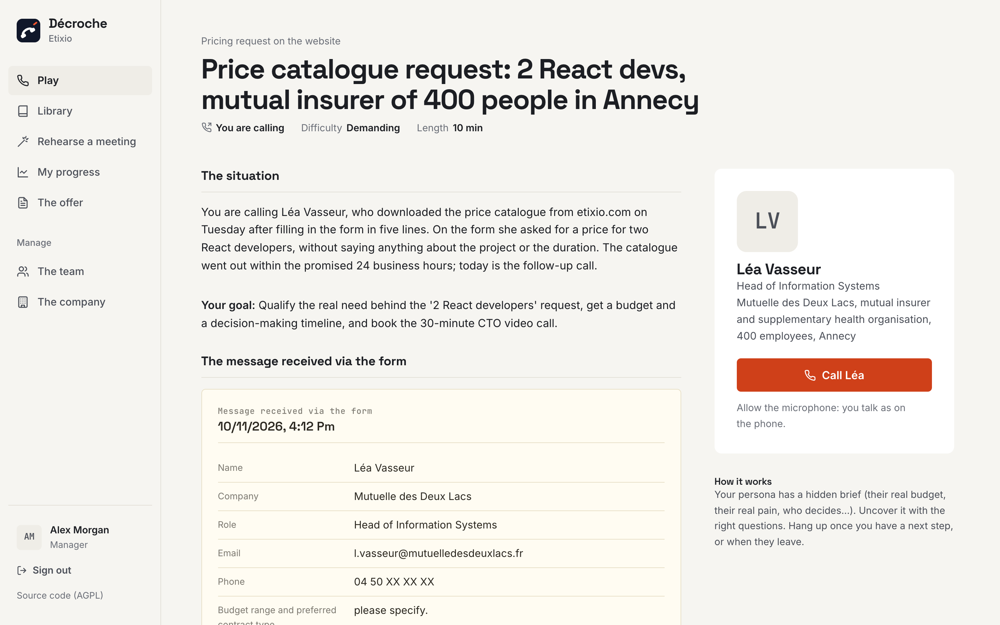
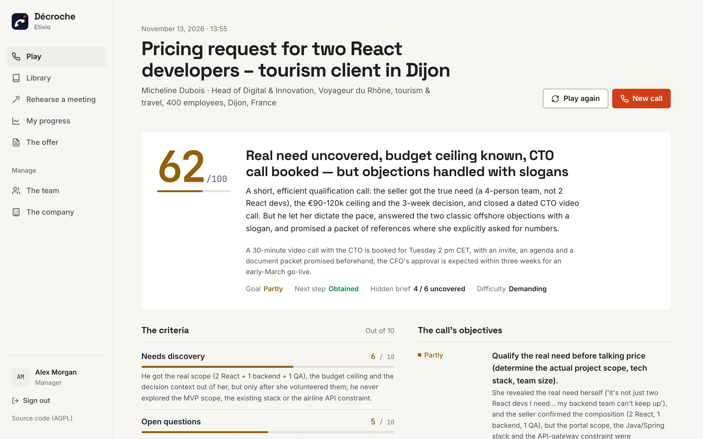
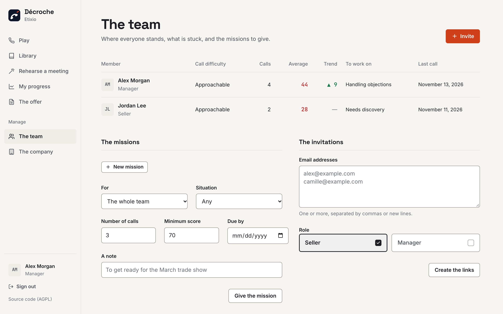
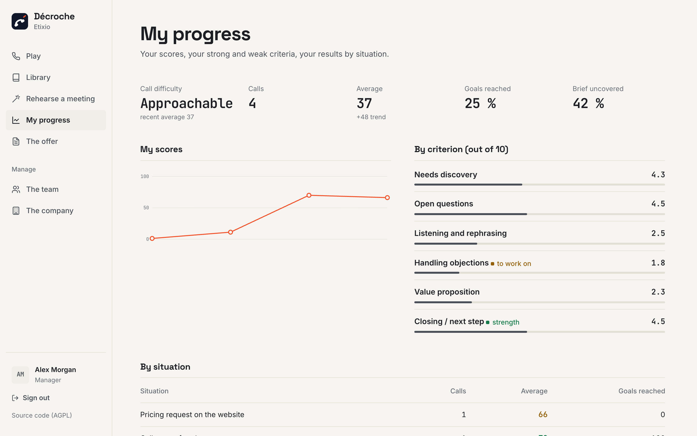
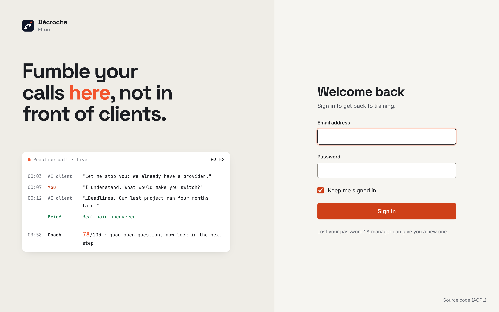

<p align="center"></p>

<h1 align="center">Décroche</h1>

<p align="center"><i>décroche</i> /de.kʁɔʃ/ — French for <i>"pick up the phone"</i>.</p>

<p align="center"><b>Rehearse your sales calls out loud, against an AI client who knows things you don't —<br>including the real client meeting you have tomorrow, straight from its e-mail thread in Claude.<br>Then get graded by a coach, and follow your progress.</b></p>

<p align="center">Symfony 8.1 · Symfony AI · MCP · Hugging Face Inference Providers · PHP 8.5</p>

<p align="center"><a href="https://mbetixio.github.io/decroche/">Website</a> · Open source (AGPL-3.0) · built for the <a href="https://symfony.com/hackathon">Symfony AI &amp; MCP Hackathon</a> 2026</p>

<p align="center"></p>

---

## Why

Sales people learn on real prospects. Every fumbled discovery question, every price given too early, every
"let me send you a brochure" costs a deal — and nobody tells them what went wrong.

**Décroche is a flight simulator for sales calls.** A seller picks up the phone (a real phone screen, with a voice,
not a chatbot) and talks to an AI client built from *their own company's* offer and situations: a price request from
the website, a furious client, a CTO who is about to leave, a renewal with a discount request… The client has a
**hidden brief** — their real budget, their real pain, who decides, their objections, what would get a yes — and only
gives it away to the right questions. When the seller hangs up, a coach grades the call against the company's own
scorecard, reveals the brief, quotes the best and worst lines, and lets them replay any moment.

One instance per company: on first boot, a step-by-step onboarding reads the company's website and writes its offer
sheet and 14–18 call situations specific to its business, in English or French.

## What it does

| | |
|---|---|
| 🎲 **Calls drawn from your own business** | The onboarding analyses your website into an offer sheet and a catalogue of situations. Each *New call* draws one at random and writes a unique scenario around it: a person, a company, the document you have in front of you (laid out like a CRM record), three objectives, and a hidden brief. |
| 📞 **A real call, out loud** | Speech recognition in the browser, neural voices generated server-side, the reply streamed and voiced sentence by sentence, interruptions (barge-in), a timer. No text box unless you want the keypad. |
| 🎯 **A debrief that teaches** | A score out of 100 on your scorecard, the call's objectives judged one by one, the hidden brief revealed with what you missed and *the question that would have found it*, your best and worst lines quoted word for word with a better alternative, three tips, talk share and filler words. Replay the call from any of your lines, or *train on this point*: a new call built to test your weakest criterion. |
| 📈 **Progress that means something** | No XP or badges: the difficulty of your next calls follows your last five scores, and the home page tells you why, your trend, and the one criterion to work on. |
| 🧑‍💼 **Managers follow the team** | The team board (difficulty, average, trend, weakest criterion per seller), each seller's debriefs, missions ("3 price-request calls scored 70+ by Friday"), invitations, the company's own library of scenarios and scorecard. |
| 🤖 **Rehearse your next real call, from Claude** | Got a client meeting tomorrow? Ask Claude (connected to your mailbox) to get you ready: it reads the meeting's e-mail thread, and Décroche turns it into a practice call with *that* client — their context, their likely objections, a hidden brief — ready to take out loud in one click. Then, still in conversation, read your debriefs, ask why you keep losing at closing, and (for managers) follow and coach the team. |

<table>
<tr>
<td width="50%"><br><sub><b>Home</b> — one action, where you stand and why, what to work on.</sub></td>
<td width="50%"><br><sub><b>Briefing</b> — the situation, the document, the objectives; the person stays in view.</sub></td>
</tr>
<tr>
<td><br><sub><b>Debrief</b> — the score, the criteria, the objectives, the call in figures.</sub></td>
<td><br><sub><b>Team</b> — each seller's difficulty, average, trend and weak spot; missions.</sub></td>
</tr>
<tr>
<td><br><sub><b>Progress</b> — scores over time, criteria, results by situation.</sub></td>
<td><br><sub><b>Onboarding</b> — the instance sets itself up from the company's website.</sub></td>
</tr>
<tr>
<td><br><sub><b>Sign-in</b> — a practice call writes itself while you sign in.</sub></td>
<td><br><sub><b>Dark theme</b> — every screen, light or dark, English or French.</sub></td>
</tr>
</table>

## Décroche in Claude (MCP)

The MCP server turns Claude (or any MCP client) into a sales coach that knows your company, your calls and your team.
Each member connects with a personal address, so Claude only ever sees what that member may see.

**Rehearse the call that is coming.** With Claude connected to your mailbox (a Gmail connector, for instance):

> *"Find the last e-mail from Satelis Mobile and get me ready for tomorrow's call with their CEO."*

Claude reads the e-mail, passes it to `prepare_call`, and Décroche writes a rehearsal of *that* meeting — the person,
their context, their likely objections and a credible hidden brief you will have to uncover. Claude hands you a
signed link: the phone screen opens in your browser, already signed in, and you rehearse out loud. A prospect sheet,
meeting notes or a CRM export work just as well.

**Understand your calls.**

> *"Show me the debrief of my last call."* · *"Compare my last three calls: what keeps going wrong at closing?"* ·
> *"Which questions would have found the budget?"*

The graded debrief appears right in the conversation (an MCP App), and `my_progress` gives Claude your scores, your
trend, your criteria and your missions to reason on.

**Coach a team** (managers).

> *"Who on my team struggles with objections? Give Jordan three objection calls scored 70+ before Friday."* ·
> *"Invite our new hire, sam@acme.com."*

**Or just practise.** *"Give me a call"* draws a surprise situation, *"Give me a call on objections"* one built to
train that criterion; with `mode: chat` the call is even played in writing, in the conversation.

**Ready-made requests.** The server also offers MCP *prompts*, in the client's "/" menu:

| Prompt | |
|---|---|
| `rehearse_meeting` | Gathers what your e-mails, calendar or notes say about an upcoming meeting, shows you the prospect sheet, then has `prepare_call` write the rehearsal. |
| `review_my_calls` | Reads your figures and debriefs, names the skill that holds you back with your own quotes, and offers a call that trains it. |
| `coach_my_team` | For managers: who progresses, who is stuck and on what, and missions to give once you approve them. |

And *resources* a client can attach to a conversation: `decroche://offer` (the offer sheet),
`decroche://situations` (the catalogue) and `decroche://scorecard` (the criteria the coach grades).

| Tool | |
|---|---|
| `prepare_call` | Writes a rehearsal of a real meeting from any text (an e-mail, notes, a prospect sheet); returns a call link or starts it in the chat. |
| `new_call`, `situations` | A surprise call drawn from the company's catalogue (or a given situation), optionally built to train one criterion (`focus`). |
| `library`, `call_link`, `start_call` | The managers' scenarios, a signed link to one, or playing it in the chat. |
| `reply`, `hang_up` | A call played in the chat: the seller's words relayed word for word, then the coach's debrief. |
| `debrief` | **MCP App**: the graded debrief, rendered in the conversation. |
| `my_progress` | Difficulty and why, scores and trend, criteria, results by situation, missions, latest calls. |
| `team`, `member_progress`, `give_mission`, `invite` | For managers. |

The persona's hidden brief never leaves the server before the debrief: the client's model cannot whisper the answers.

**Connect it.** In Décroche, open *My account → Train from Claude → Create my MCP address*, then in Claude add a
custom connector with that address (`https://your-instance/mcp?key=pcl_…`). The MCP endpoint needs a public HTTPS
address for Claude to reach it (see [Deploy](#deploy-on-a-server)).

## Run it

You need **an API key for a language model**. Décroche uses [Hugging Face Inference Providers](https://huggingface.co/docs/inference-providers)
by default — one token gives access to fast open models — and works with any OpenAI-compatible API.

### 1. Get a Hugging Face token (2 minutes)

1. Sign in or create a free account on [huggingface.co](https://huggingface.co).
2. Open [huggingface.co/settings/tokens](https://huggingface.co/settings/tokens) → **Create new token** → type
   **Fine-grained** → tick **"Make calls to Inference Providers"** → **Create token**.
3. Copy it right away: it starts with `hf_` and is shown only once.

The free account comes with a small monthly credit, enough to try. A practice call (twenty lines, the scenario and the
debrief) costs a few cents with the default model.

### 2a. With Docker (recommended)

```bash
git clone https://github.com/<you>/decroche.git && cd decroche
echo "AI_API_KEY=hf_your_token" > .env.docker
docker compose --env-file .env.docker up -d --build
```

Open <http://localhost:7077>. Then choose:

- **A real instance, set up from your company** (default): the onboarding starts. Pick the language, create the first
  manager account, give your website (analysed in a minute or two), review the offer, the situations and the
  scorecard, invite your team.
- **A demo instance, with test data**: add `DECROCHE_DEMO=1` to `.env.docker` before starting.

  ```bash
  echo "DECROCHE_DEMO=1" >> .env.docker
  docker compose --env-file .env.docker up -d --build
  docker compose logs decroche | grep -A1 Manager     # the demo manager's e-mail and password
  ```

  The onboarding is skipped: an example company (a software services firm), its 24 situations, a library of 7
  scenarios, and a small team are created. You sign in as its manager, Alex Morgan, who already has four debriefed
  calls (scores climbing from 1 to 70) next to a junior seller's two, so the home page, the progress, the team board
  and the MCP statistics are full from the start. `DECROCHE_LANGUAGE=fr` gives the same in French.

The database, the sessions, the synthesized voices and the instance's own secrets live in the `decroche` volume:
`docker compose down` keeps them, `docker compose down -v` starts over.

### 2b. Without Docker

Requires PHP 8.5 with `pdo_sqlite` and `intl`, [Composer](https://getcomposer.org), and Python 3 for the voices.

```bash
git clone https://github.com/<you>/decroche.git && cd decroche
composer install
echo "AI_API_KEY=hf_your_token" > .env.local     # never committed
python3 -m venv var/edge-tts && var/edge-tts/bin/pip install edge-tts==7.3.1   # optional: neural voices
```

Then either the onboarding:

```bash
php bin/console app:install            # creates the database; the first visit opens the onboarding
```

or the demo data:

```bash
php bin/console app:install --demo --language=en    # the example company, team and calls; prints the manager's e-mail and password
```

and serve it:

```bash
symfony serve        # or: php -S 127.0.0.1:8000 -t public
```

**Use Chrome, Edge or Safari** (speech recognition) and allow the microphone. Without a microphone, the keypad on the
phone screen lets you type your lines. Without edge-tts, the browser's own voice speaks.

## Configuration

Put your values in `.env.local` (without Docker) or `.env.docker` (with Docker). Only `AI_API_KEY` is required.

| Variable | Default | |
|---|---|---|
| `AI_API_KEY` | — | **Required.** Your model provider's key: a Hugging Face token `hf_…` by default. |
| `AI_BASE_URL` | `https://router.huggingface.co/v1` | Any OpenAI-compatible endpoint (see below). |
| `AI_PERSONA_MODEL` | `deepseek-ai/DeepSeek-V4.1-Flash` | The client on the phone: its reply is streamed, so it must start fast. |
| `AI_COACH_MODEL` | `deepseek-ai/DeepSeek-V4.1-Flash` | The coach and the writers (debriefs, scenarios, offer sheet), as structured output. The same model twice is fine. |
| `AI_PERSONA_REASONING`, `AI_COACH_REASONING` | `low`, `low` | Reasoning effort, `none` to `high`, sent the way the model family expects it (gpt-oss, gpt-5, DeepSeek). |
| `AI_COMPLETIONS_PATH` | `/chat/completions` | |
| `AI_HEADERS` | `{}` | Extra HTTP headers for the model's API, as JSON. |
| `DEFAULT_URI` | `http://127.0.0.1:8000` | The instance's public address, for the links it generates (call links, invitations). |
| `MCP_ALLOWED_HOSTS` | `localhost,127.0.0.1,…` | Host names the MCP endpoint answers on: add your domain. |
| `TRUSTED_PROXIES` | — | Your reverse proxy, e.g. `private_ranges`. |
| `SOURCE_URL` | this repository | Where your users can get the source code, linked at the foot of every page (AGPL-3.0): point it at your fork if you modify Décroche. |
| `DECROCHE_DEMO`, `DECROCHE_LANGUAGE` | `0`, `en` | Docker only: load the demo data instead of the onboarding. |
| `DECROCHE_PORT` | `7077` | Docker only: the port on your machine. |
| `EDGE_TTS`, `VOICES_DIR` | `var/edge-tts/bin/edge-tts`, `var/voices` | The neural voices and their cache. |

**Choosing a model.** The persona answers in one to four sentences and must start *fast* (it is a phone call); the
coach reads the whole call against the offer and must be precise. We compared three set-ups on six real calls, with
the app's own prompts:

| | First word on the phone (median) | Debrief | Debrief quality |
|---|---|---|---|
| `deepseek-ai/DeepSeek-V4.1-Flash` on Hugging Face (**default**) | **1.5 s**, steady (0.6–1.9 s) | 7–12 s | **The most precise**: notices a question asked twice, quotes the offer's real arguments |
| `openai/gpt-oss-120b` on Hugging Face | 2.1 s, uneven (up to 5.5 s) | **2–3 s** | Correct but more generic |
| DeepSeek V4.1 Flash on another provider | 1.8 s | 9–12 s | As precise as the default |

Reasoning made the debriefs slower (about 20 s) without making them better, so it is off by default. For instant
debriefs, set `AI_COACH_MODEL=openai/gpt-oss-120b`. Other providers:

| Provider | `AI_BASE_URL` | Both models |
|---|---|---|
| Hugging Face (default) | `https://router.huggingface.co/v1` | `deepseek-ai/DeepSeek-V4.1-Flash` |
| OpenAI | `https://api.openai.com/v1` | `gpt-5.4-mini` |
| DeepSeek | `https://api.deepseek.com/v1` | `deepseek-chat` |
| A local Ollama | `http://localhost:11434/v1` | `qwen3:32b` |

## Deploy on a server

`docker compose up -d --build` on any server, behind your HTTPS reverse proxy (Caddy, Traefik, Nginx Proxy Manager…)
pointing at port 7077. Set `DEFAULT_URI=https://your-domain` and add the domain to `MCP_ALLOWED_HOSTS` so that call
links, invitations and the MCP endpoint use it. The container migrates the database and prunes old voices at each
start.

**The landing page** is a single static file, `docs/index.html` (English and French, the same design as the app). To
publish it with GitHub Pages: *Settings → Pages → Deploy from a branch → `main`, `/docs`*.

## How Symfony AI, MCP and Hugging Face are used

- **Two jobs, two models, through Symfony AI.** `App\Ai\LanguageModel` wraps a Symfony AI *generic* platform declared
  in `config/packages/ai.yaml`, pointed at Hugging Face Inference Providers by default: one model plays the persona
  (streamed), the other coaches and writes, each with its own reasoning effort.
- **Structured output.** The coach, the scenario writers and the offer analyst answer into classes
  (`src/Ai/Output/`, described with `#[Schema]` attributes): Symfony AI sends each class as a strict JSON schema
  (`response_format`) and turns the model's JSON back into the object (`asObject()`). The criteria come as a list,
  since every company writes its own scorecard.
- **Streaming end to end.** The persona's reply is a stream of `TextDelta`s (`Persona::reply()`), filtered of its
  control markers (`[devoiler:budget]` when a brief section is given away, `[fin]` when the persona hangs up), cut into
  sentences (`SentenceSplitter`), each voiced in parallel by edge-tts (`TurnStreamer`) and sent to the browser as NDJSON
  as soon as its voice is ready.
- **MCP tools, prompts and resources as plain Symfony services.** `src/Mcp/*Tools.php` methods carry `#[McpTool]`,
  `Prompts` `#[McpPrompt]` and `CompanyResources` `#[McpResource]`; schemas come from the signatures. A stateless firewall authenticates each member by a personal key (`McpKeyAuthenticator`), redacted from
  the logs.
- **Call links.** `CallLinks` uses Symfony's login links (signed with the member's password hash, 15 minutes, a few
  uses) with a target path: the model hands the seller a link, and the phone screen opens already signed in.
- **An MCP App.** `DebriefApp` (`#[AsMcpApp]`) renders the debrief with the site's own Twig partial and stylesheet.
- **Tests without the network.** `tests/Fake/ScriptedModel` builds a Symfony AI `MockPlatformFactory` platform that
  answers each kind of prompt, with the structured output subscriber, so the whole suite — onboarding, a streamed
  call, the MCP server — runs offline.

## Architecture

```
src/
  Ai/           LanguageModel (Symfony AI), Output/ (the structured answers), Data (typed reading of stored JSON)
  Call/         CallManager (start, talk, expire, finish, abandon, replay), TurnStreamer, SentenceSplitter
    Persona/    the persona's prompt, its streamed reply and marker filter
    Coach/      the coach's prompt, the debrief and its scoring
    Speech/     talk share, questions, filler words, pace
  Scenario/     situation canvas and drawer, scenario writer and factory, surprise calls
  Company/      website reader (private networks refused), offer analyst, example company and calls, team and missions
  Progress/     a member's figures, the difficulty that follows their scores, the team board, missions
  Voice/        edge-tts synthesis and its cache pruning, voice casting per language, gender and tone
  Mcp/          the MCP tools, prompts and resources, the debrief app, call links
  Onboarding/   the steps and the guard that steers first-boot visitors
  Controller/   thin controllers; Form/ typed models validated with constraints; Twig/ the CRM-style document
  Entity/ Enum/ Model/ Repository/  the domain
templates/      Twig with anonymous Twig components; assets/ Stimulus controllers and one CSS design system (light and dark)
translations/   English and French; config/decroche/{en,fr}/ the example company, its calls and the situation canvas
```

## Quality

```bash
php vendor/bin/phpunit                    # 300+ unit and functional tests, offline, in a few seconds
vendor/bin/phpstan analyse                # level max, with the Symfony and Doctrine extensions
vendor/bin/php-cs-fixer fix --dry-run     # Symfony coding standard, strict types everywhere
```

Accessible (WCAG AA contrasts, keyboard, reduced motion), responsive down to 360 px, every page in English and French.
A company's instance stays out of search engines (`noindex`, `robots.txt`).

## Maintenance

- `php bin/console app:prune-voices --days=30` deletes the cached voices not heard for 30 days. It also runs at each
  container start and, now and then, on its own: no cron needed.
- Expired sessions are cleaned up by PHP. Calls and debriefs are kept: they are the members' history.

## Built for the Symfony AI & MCP Hackathon

Décroche was built for the [Symfony AI & MCP Hackathon](https://symfony.com/hackathon) (26 October – 22 November
2026), to show what Symfony AI and the PHP MCP SDK make possible in a real product: a model playing a person on the
phone in real time, a coach grading structured feedback, and the same product reachable from Claude — down to
rehearsing tomorrow's client meeting from its e-mail thread.

## License

Décroche is free and open source software, released under the [GNU Affero General Public License v3](LICENSE)
(AGPL-3.0-or-later). You may use it, study it, modify it and run your own instance, for free. If you modify it and
offer it to others as a network service, you must make your modified source code available to them under the same
license.

